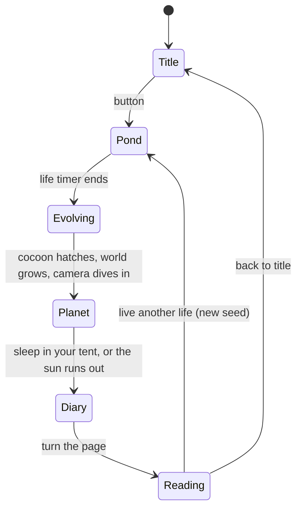

# Evol

You start as a fish. What you do in the pond decides what you evolve into, which tiny world you move to,
the tiny world that grows around you, and what its residents (and a very nosy doctor) figure out about you.

Evol mixes three inspirations: **Doki Doki Universe** (tiny planets full of residents with likes, dislikes and
requests, summoned stickers, quiz asteroids and a personality doctor), **LittleBigPlanet** (a handmade craft-box
look: felt, cardboard, stitched panels and a sticker menu), and the Sims world-select circles and TikTok "choose a planet" edits, which show how every
world can look completely different. Every life is different, like a Minecraft seed: the pond is generated
from a seed, and an AI turns how you played into a new creature, its own one-of-a-kind world (base biome, colors, props, mood), and that world's residents.

Built for the IEEE CS Game Sprint, KSU AI Club Hackathon 2026, by Micah Mosley.

## How to play

| Control | Keyboard | Arduino controller |
|---|---|---|
| Move, pick in menus | Arrow keys or WASD | Joystick |
| Bite, interact, confirm | Space or Enter | Press the joystick down (its button) |

1. **The pond (75 s).** You're a small fish. Eat pondweed, bugs or minnows; pick things up; hide in reeds. Bite the pike from behind and it flees, head-on and it bites back. A heron can take your tail. Each seed picks 4 random events: a frog, a turtle you can hide under, fish eggs and a crayfish raiding them, a kid's net, a baited hook (mash to escape), a fish tangled in fishing line you can free, or a rain shower full of bugs.
2. **Evolving (one transition, no menus).** Your fish spins into a felt cocoon in space while your pond moments drift past. It hatches into what you earned, then your own tiny world grows under your feet, prop by prop, and the camera dives down to land you there. The AI starts from one of 8 base biomes (bayou, desert, suburb, spooky, harbor, sunset, pines, jungle) and repaints it with its own sky, ground, props and particles, so no two lives look alike.
3. **The planet.** Walk all the way around a tiny planet; it turns under your feet. Walk up to a resident and press the button:
   - **Talk:** first meeting reveals their request; after that they gossip about the neighbors ("never show Bo a rain cloud").
   - **Greet:** wave, bow, blow a kiss or dance. Everyone has a favorite.
   - **Sticker:** summon a sticker on the moment (puppy, ghost, cake, poop...). Loved ones win hearts; hated ones don't.
   - **Pick up:** carry them. Throw them into the sky, or set them down next to someone to introduce them.
   - **Card:** their identity card. Likes, dislikes and greeting start as ❔ and fill in as you learn.
   Finish a request and they give you a present: new stickers. Two quiz moths float nearby with odd picture questions. Sleep in your tent when the sun runs out.
4. **Diary.** A page with a photo of the day and a sticker naming who you were.
5. **Dr. Wobble's reading.** An archetype, three observations, and the receipts: the exact moments the reading is based on. Then live another life.

There's no single win. You win a life by surviving the pond and making friends (4+ hearts) and finishing requests on your planet.
Lose conditions in the pond (bitten, hooked, netted, tail lost) don't end the game; they change what you become.

`?quick` shortens the pond and the day for demos. `?debug` exposes the state machine as `window.evol` for testing.

## State machine



Inside Planet, the interaction menu, greetings, stickers, identity cards, carrying, quizzes and the sleep prompt are
overlay modes (walk, menu, greet, stickers, card, talk, carry, quiz, home), not separate states.
Every frame: read input → update the scene → render 3D → draw the 2D overlay.

## Where the AI is

All prompts are in `js/ai/prompts.js`. The AI runs through Claude on claude.ai (no API keys). If it's unavailable,
`js/life/fallback.js` builds everything offline, so the game never stops.

| Moment | What the AI decides |
|---|---|
| Evolving (1) | Creature body, color and name, why you became it, and its own world: base biome, name, sky and ground colors, prop mix, particles, vibe |
| Evolving (2) | The residents: personalities, identity cards (likes, dislikes, greeting), requests, every line they say, and two quiz moths with picture questions that score personality |
| Night | The diary page and the day's sticker |
| The end | Dr. Wobble's archetype, three observations, the receipts, and a question, never repeating past lives |

Gossip is generated by the game from the real identity cards, so it's always true. Personality is tracked on 7
hidden axes (curious, kind, bold, calm, social, playful, driven), plus stats on how you treated people: cards read
before acting, pranks with stickers you knew they hated, tosses, introductions, requests finished.

## Hardware (bonus)

ELEGOO Mega 2560 + joystick module (its button is the action button), optional active buzzer and LED for feedback.
Wiring and code: `arduino/evol_controller/evol_controller.ino`. Connect with the in-game "Connect joystick" button
(Web Serial), or run `python bridge/serial_to_keys.py` to turn the joystick into arrow keys.

## Code map

```
index.html                 page: 3D canvas + overlay canvas
js/main.js                 boot, scenes, game loop
js/core/game.js            game state, personality axes, scene state machine
js/core/stage.js           Three.js renderer, screen projection, snapshots
js/core/input.js           keyboard, gamepad, Arduino (Web Serial)
js/core/palette.js         colors and fonts (felt, cardboard, sticker colors)
js/core/draw.js            overlay UI: stitched panels, stickers, dialogue, labels
js/core/audio.js           synthesized water, blips and a music box per planet
js/core/rng.js, store.js   seeded random, saved lives
js/gfx/models.js           every low-poly model, built in code
js/gfx/sky.js              sky for the pond and evolving scenes
js/gfx/biomes.js           the 8 worlds, their props, stickers and greetings
js/gfx/planet.js           tiny walkable planet, felt ground, world skies
js/ai/claude.js            AI call with timeout, validation and fallback
js/ai/prompts.js           every prompt
js/life/schema.js          validates whatever the AI returns
js/life/traits.js          pond actions -> sentences and personality
js/life/fallback.js        offline creature, worlds, residents, quizzes, diary, reading
js/scenes/*.js             title, pond, evolving, planet, diary, reading
js/vendor/three.min.js     Three.js r128 (MIT)
arduino/, bridge/          controller sketch and joystick bridge
```

## Limitations and challenges

- **Limitation:** the AI needs a connection and permission on claude.ai. Offline, the game still works, but with less variety.
- **Limitation:** browsers inside claude.ai may block USB, so the joystick may need the Python bridge.
- **Limitation:** 3D with shadows needs a reasonably modern laptop; very old machines will run slowly.
- **Challenge:** making randomness feel earned. The AI only sees what you actually did, and the game shows you that list before the reveal.
- **Challenge:** AI answers are unpredictable, so every answer goes through a validator that repairs or replaces anything broken.
- **Challenge:** walking on a sphere. The player never moves: the planet rotates under them, and residents wander in the planet's own coordinates.
- **Challenge:** Doki Doki style insight without judging single actions. The reading looks for patterns across the pond, the planet and the quizzes, and shows its receipts.

## Resources and credits

- Claude (Anthropic): in-game AI, and the coding assistant used to build the game
- Three.js r128 (MIT license), WebGL, Web Serial API, Web Audio API
- Fonts: Fredoka, Patrick Hand (Google Fonts); emoji for stickers
- Arduino IDE; ELEGOO Mega 2560 kit; Python pyserial and pynput for the bridge
- Inspiration: Doki Doki Universe, LittleBigPlanet, the Sims world select, TikTok "choose a planet" edits, Minecraft seeds
- No outside art or audio: every model and sound is made in code
