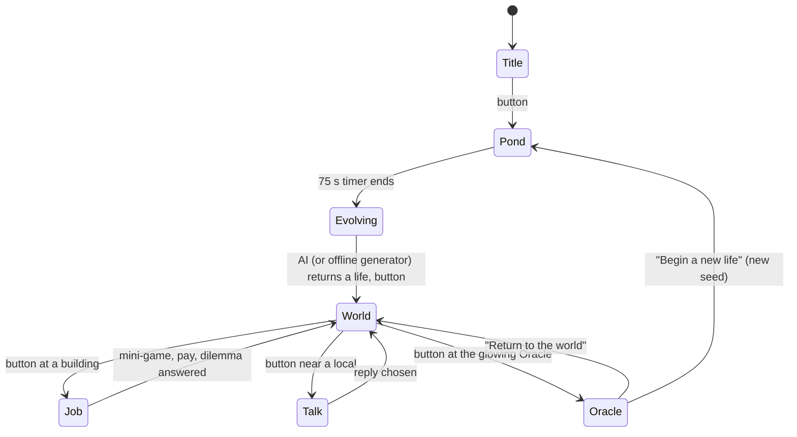

# Evol

You start as a fish. What you do in the pond decides what you evolve into, and the world you live in after.
Every run is different, like a Minecraft seed: the pond is generated from a seed, and an AI turns your
behavior into a new creature, world, cast of characters and set of jobs. An Oracle in each world reads
everything you did and tells you something new about yourself each life.

Built for the IEEE CS Game Sprint, KSU AI Club Hackathon 2026, by Micah Mosley.

## How to play

| Control | Keyboard | Arduino controller |
|---|---|---|
| Move | Arrow keys or WASD | Joystick |
| Bite, pick up, choose, talk | Space or Enter | Press the joystick down (its button) |

1. **Pond (75 seconds).** Swim, eat, explore, pick things up, avoid the pike and the heron. Hiding in reeds keeps you safe. A heron strike can take your tail, which makes you slower for the rest of your life.
2. **Evolving.** The game shows what you did, then the AI reveals what you became and why.
3. **Your world (sandbox).** Walk around. Take jobs (mini-games) to earn the world's currency, talk to the locals, and visit the Oracle whenever you want.
4. **Oracle.** Get an insight built from your choices, then return to the world or begin a new life.

**Goal:** there is no single win. You "win" a life by surviving the pond and building a life in your world. Score is your currency, jobs done and choices made. Lose condition in the pond: the pike bites you twice (you still evolve, but scarred). Difficulty rises inside each mini-game (faster drops, smaller timing zones, longer recipes).

Add `?quick` to the URL for a 25 second pond (good for short demos). Add `?debug` to expose the state machine as `window.evol` for testing.

## State machine



Every frame: read input (keyboard, gamepad or Arduino) → update the current scene → draw it.

## Where the AI is

All prompts are in `js/ai/prompts.js`. The AI runs through Claude on claude.ai (no API keys). If it is
unavailable, `js/life/fallback.js` and `js/life/fallbacks.js` generate offline versions, so the game never stops.

| Moment | What the AI decides |
|---|---|
| Evolving | Creature body (shape, limbs, eyes, features), name, why you became it, the world's colors, scenery, currency, 3 NPCs and 3 jobs |
| End of each job | A new dilemma for that world, different from your past choices |
| Talking to a local | What they say in character, reacting to who you became and what you chose |
| Oracle | A new insight connecting your pond behavior and your choices, never repeating earlier lives |

Procedural generation (not AI): the pond layout from the seed, creature drawing from the body description (`js/life/creature.js`), world scenery (`js/life/props.js`).

## Hardware (bonus)

ELEGOO Mega 2560 + joystick module (its button is the action button), optional active buzzer and LED for feedback.
Wiring and code: `arduino/evol_controller/evol_controller.ino`.

Two ways to connect:
1. **Direct:** click "Connect joystick (USB)" under the game (Chrome or Edge, Web Serial).
2. **Bridge:** if the page can't open USB, run `python bridge/serial_to_keys.py`. It turns the joystick into arrow keys and Space.

## Code map

```
index.html                 page + canvas
css/style.css              page chrome
js/main.js                 boot, scene registration, game loop
js/core/game.js            shared game state + scene state machine
js/core/input.js           keyboard, gamepad, Arduino (Web Serial) input
js/core/rng.js             seeded random numbers
js/core/draw.js            text, panels, buttons, math helpers
js/core/store.js           saves past lives (browser storage)
js/ai/claude.js            AI connection with timeout + fallback
js/ai/prompts.js           every AI prompt
js/life/schema.js          the shape of a "life" and its validator
js/life/traits.js          pond numbers -> plain sentences and tags
js/life/fallback.js        offline evolution
js/life/fallbacks.js       offline dilemmas, chats, insights
js/life/creature.js        procedural creature drawing
js/life/props.js           procedural scenery per world type
js/jobs/catch.js           mini-game: catch good, dodge bad
js/jobs/timing.js          mini-game: press in the gold zone
js/jobs/recipe.js          mini-game: follow the order
js/scenes/*.js             title, pond, evolving, world, job, talk, oracle
arduino/                   controller sketch
bridge/serial_to_keys.py   joystick-to-keyboard bridge
```

## Limitations and challenges

- **Limitation:** the AI needs a connection and permission on claude.ai. Without it the offline generator works, but its creatures and worlds are less varied.
- **Limitation:** browsers inside claude.ai may block USB, so the joystick may need the Python bridge.
- **Challenge:** making randomness feel earned. The AI only sees what the player actually did, and the evolving screen shows those actions before the reveal, so players can see why they became what they became.
- **Challenge:** AI answers are unpredictable, so every answer goes through a validator (`js/life/schema.js`) that fixes or replaces anything broken before the game uses it.

## Resources and credits

- Claude (Anthropic) as the in-game AI and as the coding assistant used to build the game
- Fonts: Bricolage Grotesque and Figtree (Google Fonts)
- Arduino IDE; ELEGOO Mega 2560 kit
- Python libraries for the bridge: pyserial, pynput
- No outside art or audio: every graphic is drawn in code
