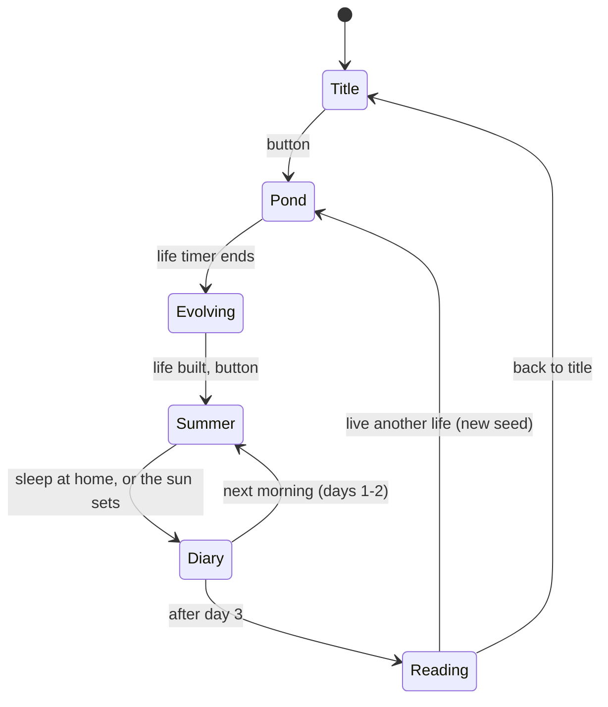

# Evol

You start as a fish. What you do in the pond decides what you evolve into, and the summer you live after.

Evol mixes three games: **Superhot** (time only moves when you move, a white world where only living
things are red), **Boku no Natsuyasumi** (a slow, nostalgic summer in the countryside with a diary every night),
and **Doki Doki Universe** (odd little questions that add up to a playful read on who you are).
Every life is different, like a Minecraft seed: the pond is generated from a seed, and an AI turns how you
played into a new creature, a village, its people and its questions.

Built for the IEEE CS Game Sprint, KSU AI Club Hackathon 2026, by Micah Mosley.

## How to play

| Control | Keyboard | Arduino controller |
|---|---|---|
| Move | Arrow keys or WASD | Joystick |
| Bite, grab, talk, choose | Space or Enter | Press the joystick down (its button) |

1. **The pond.** You're a small fish. Time only moves when you move: stop, and the pond nearly freezes, so you can plan. Eat pondweed, bugs or minnows; pick things up; hide in reeds. Bite the pike from behind and it flees, head-on and it bites back. A heron can take your tail. Each seed also picks 4 random events: a frog, a turtle you can hide under, fish eggs and a crayfish raiding them, a kid's net, a baited hook (mash to escape), a fish tangled in fishing line you can free, or a rain shower full of bugs.
2. **Evolving.** The game lists what you did, then the AI reveals what you became and why.
3. **Summer (3 days).** A free-roam sandbox village. The sun only moves as you walk. Gather materials, catch critters, help villagers with what they need, build the village project, and answer odd questions from talking objects. Sleep at home to end the day.
4. **Diary.** Every night you write a page: a photo of where you fell asleep, what happened, and a sticker naming who you were today.
5. **The reading.** After day 3 you get an archetype and three observations that connect the pond, the village and your answers. Then live another life.

There's no single win. You win a life by surviving the pond and making a summer worth writing about.
Lose conditions in the pond (bitten, hooked, netted, tail lost) don't end the game; they change what you become.

`?quick` shortens the pond and days for demos. `?debug` exposes the state machine as `window.evol` for testing.

## State machine



Inside Summer, talking, questions, gifts and the sleep prompt are overlays, not separate states.
Every frame: read input → update the scene (world time scaled by how much you move) → render 3D → draw overlay.

## Where the AI is

All prompts are in `js/ai/prompts.js`. The AI runs through Claude on claude.ai (no API keys). If it's unavailable,
`js/life/fallback.js` builds everything offline, so the game never stops.

| Moment | What the AI decides |
|---|---|
| Evolving | Creature body and name, why you became it, the village, its project, resources, critters, 4 villagers and what they want, 6 talking objects with Doki Doki style questions and how each answer scores personality |
| Talking to villagers | What they say in character, noticing what you've done; your reply also scores personality |
| Each night | The diary page and the day's sticker |
| The end | Your archetype and three observations, never repeating past lives |

Personality is tracked on 7 hidden axes (curious, kind, bold, calm, social, playful, driven), fed by the pond,
what you do in the village, and your answers.

## Hardware (bonus)

ELEGOO Mega 2560 + joystick module (its button is the action button), optional active buzzer and LED for feedback.
Wiring and code: `arduino/evol_controller/evol_controller.ino`. Connect with the in-game "Connect joystick" button
(Web Serial), or run `python bridge/serial_to_keys.py` to turn the joystick into arrow keys.

## Code map

```
index.html                 page: 3D canvas + overlay canvas
js/main.js                 boot, scenes, game loop
js/core/game.js            game state, personality axes, scene state machine
js/core/stage.js           Three.js renderer, screen projection, snapshots
js/core/input.js           keyboard, gamepad, Arduino (Web Serial)
js/core/palette.js         colors and fonts (white world, red life, summer sky)
js/core/draw.js            overlay UI: boxes, dialogue, choices, labels
js/core/audio.js           synthesized cicadas, water and blips
js/core/rng.js, store.js   seeded random, saved lives
js/gfx/models.js           every low-poly model, built in code
js/gfx/sky.js              summer sky, clouds, sun by time of day
js/ai/claude.js            AI call with timeout, validation and fallback
js/ai/prompts.js           every prompt
js/life/schema.js          validates whatever the AI returns
js/life/traits.js          pond actions -> sentences and personality
js/life/fallback.js        offline life, chats, diary and reading
js/scenes/*.js             title, pond, evolving, summer, diary, reading
js/vendor/three.min.js     Three.js r128 (MIT)
arduino/, bridge/          controller sketch and joystick bridge
```

## Limitations and challenges

- **Limitation:** the AI needs a connection and permission on claude.ai. Offline, the game still works, but with less variety.
- **Limitation:** browsers inside claude.ai may block USB, so the joystick may need the Python bridge.
- **Limitation:** 3D with shadows needs a reasonably modern laptop; very old machines will run slowly.
- **Challenge:** making randomness feel earned. The AI only sees what you actually did, and the game shows you that list before the reveal.
- **Challenge:** AI answers are unpredictable, so every answer goes through a validator that repairs or replaces anything broken.
- **Challenge:** "time only moves when you move" had to work for the whole world at once, so every system updates with a scaled clock.

## Resources and credits

- Claude (Anthropic): in-game AI, and the coding assistant used to build the game
- Three.js r128 (MIT license), WebGL, Web Serial API, Web Audio API
- Fonts: DM Serif Display, Zen Kaku Gothic New, Klee One (Google Fonts)
- Arduino IDE; ELEGOO Mega 2560 kit; Python pyserial and pynput for the bridge
- Inspiration: Superhot, Boku no Natsuyasumi, Doki Doki Universe, Minecraft seeds
- No outside art or audio: every model and sound is made in code
