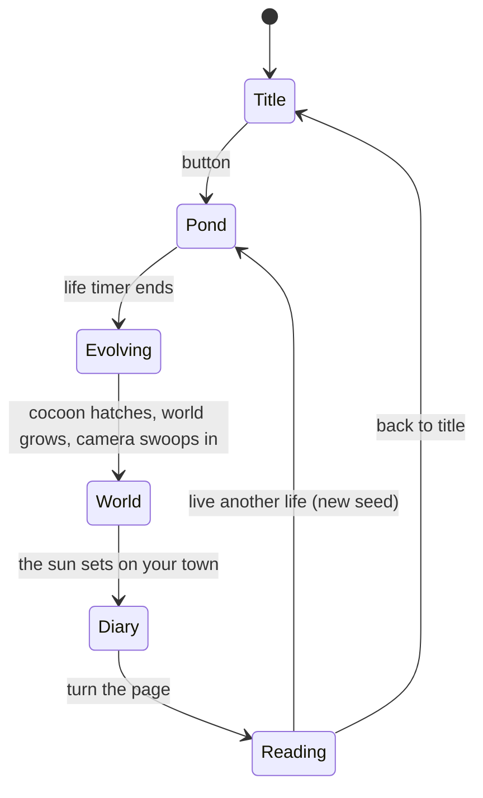

# Evol

You start as a fish. What you do in the pond decides what you evolve into and the world that grows around
you. Then you build a town in it, and Dr. Wobble reads who you are from how you lived and how you built.

Inspirations: **Townscaper** (tap to build and the town shapes itself), **Tiny Glade** (soft, beautiful worlds
with warm light), **Minecraft seeds** (a whole world from one number), and **Doki Doki Universe** (a playful
personality doctor that notices patterns you didn't). Built for the IEEE CS Game Sprint, KSU AI Club Hackathon 2026, by Micah Mosley.

## How to play

| Control | Keyboard | Arduino controller |
|---|---|---|
| Swim, move the build cursor | Arrow keys or WASD | Joystick |
| Bite / grab; tap to build | Space or Enter (tap) | Press the joystick down (its button) |
| Take a floor away | Hold Space | Hold the joystick button |

1. **The pond (75 s).** You're a small fish. Eat pondweed, bugs or minnows; pick things up; hide in reeds. Bite the pike from behind and it flees, head-on and it bites back. A heron can take your tail. Each seed picks 4 random events: a frog, a turtle you can hide under, fish eggs and a crayfish raiding them, a kid's net, a baited hook (mash to escape), a fish tangled in fishing line you can free, or a rain shower full of bugs.
2. **Evolving (one transition, no menus).** Your fish spins into a cocoon in space while your pond moments drift past. It hatches into what you earned, then your world rises out of nothing far below you: hills, lakes, then groves of trees popping in from the middle outward. The camera swoops down to where you'll build.
3. **Build (4 minutes, Townscaper style).** Move the cursor and tap to add a floor; hold to take one away. You never pick walls or roofs: houses join into rows, windows appear only where a wall faces open air, doors face open ground, gables run along a row, a lone tall stack becomes a tower with a spire, enclosed tops become roof gardens, and anything over the lake stands on a pier. At dusk the windows light up.
4. **Diary.** A page with a photo of your town and a sticker naming who you were.
5. **Dr. Wobble's reading.** An archetype, three observations connecting how you swam to how you built, and the receipts: the exact moments and numbers it's based on. Your town sits on his desk as a diorama. Then live another life.

There's no score to beat. Every life is a different creature, a different world and a different town.
Pond dangers (bitten, hooked, netted, tail lost) don't end the game; they change what you become.

`?quick` shortens the pond and the day for demos. `?debug` exposes the state machine as `window.evol` for testing.

## State machine



Inside World, building is just two inputs: tap adds a floor, hold removes one. The town rebuilds the
touched cell and its four neighbors so walls, windows and roofs always agree.
Every frame: read input → update the scene → render 3D → draw the 2D overlay.

## Where the AI is

All prompts are in `js/ai/prompts.js`. The AI runs through Claude on claude.ai (no API keys). If it's unavailable,
`js/life/fallback.js` builds everything offline, so the game never stops.

| Moment | What the AI decides |
|---|---|
| Evolving | Creature body, color and name, why you became it, and its world: base biome, name, sky and ground colors, mood, and your building colors |
| Night | The diary page and the day's sticker |
| The end | Dr. Wobble's archetype, three observations, the receipts, and a question, never repeating past lives |

The town is measured for the reading: buildings, floors, tallest stack, towers, piers over water, how many
separate clusters, how tightly packed, how many floors you took back down, and how long you waited before the
first stone. Personality is also tracked on 7 hidden axes from the pond (curious, kind, bold, calm, social, playful, driven).

## Hardware (bonus)

ELEGOO Mega 2560 + joystick module (its button is the action button), optional active buzzer and LED for feedback.
Wiring and code: `arduino/evol_controller/evol_controller.ino`. Connect with the in-game "Connect joystick" button
(Web Serial), or run `python bridge/serial_to_keys.py` to turn the joystick into arrow keys.

## Code map

```
index.html                 page: 3D canvas + overlay canvas
js/main.js                 boot, scenes, game loop
js/core/game.js            game state, personality axes, scene state machine
js/core/stage.js           Three.js renderer, screen projection, snapshots
js/core/input.js           keyboard, gamepad, Arduino (Web Serial)
js/core/palette.js         colors and fonts (felt, cardboard, sticker colors)
js/core/draw.js            overlay UI: stitched panels, stickers, dialogue, labels
js/core/audio.js           synthesized water, blips and a music box per world
js/core/rng.js, store.js   seeded random, saved lives
js/gfx/models.js           every low-poly model, built in code
js/gfx/sky.js              sky for the pond and evolving scenes
js/gfx/biomes.js           the 8 worlds, their props, stickers and greetings
js/gfx/terrain.js          the world from a seed: smooth meadows, lakes, groves, sky and light
js/gfx/town.js             Townscaper-style building: floors, walls, windows, doors, roofs, towers, piers
js/gfx/planet.js           small floating planets on the title screen
js/ai/claude.js            AI call with timeout, validation and fallback
js/ai/prompts.js           every prompt
js/life/schema.js          validates whatever the AI returns
js/life/traits.js          pond actions -> sentences and personality
js/life/fallback.js        offline creature, world, diary and reading
js/scenes/*.js             title, pond, evolving, world, diary, reading
js/vendor/three.min.js     Three.js r128 (MIT)
arduino/, bridge/          controller sketch and joystick bridge
```

## Limitations and challenges

- **Limitation:** the AI needs a connection and permission on claude.ai. Offline, the game still works, but with less variety.
- **Limitation:** browsers inside claude.ai may block USB, so the joystick may need the Python bridge.
- **Limitation:** 3D with shadows needs a reasonably modern laptop; very old machines will run slowly.
- **Challenge:** making randomness feel earned. The AI only sees what you actually did, and the game shows you that list before the reveal.
- **Challenge:** AI answers are unpredictable, so every answer goes through a validator that repairs or replaces anything broken.
- **Challenge:** a whole world from one number. Seeded value noise makes the hills, lakes and coast; trees grow in groves with open meadows between; the building ground stays gentle and always has a lake beside it.
- **Challenge:** Townscaper with one button. Every cell only stores a height; each house's shape is worked out from its neighbors whenever anything changes.
- **Challenge:** insight without judging single actions. The reading looks for patterns across the pond and the town, and shows its receipts.

## Resources and credits

- Claude (Anthropic): in-game AI, and the coding assistant used to build the game
- Three.js r128 (MIT license), WebGL, Web Serial API, Web Audio API
- Fonts: Fredoka, Patrick Hand (Google Fonts); emoji for stickers
- Arduino IDE; ELEGOO Mega 2560 kit; Python pyserial and pynput for the bridge
- Inspiration: Townscaper, Tiny Glade, Minecraft seeds, Doki Doki Universe
- No outside art or audio: every model and sound is made in code
